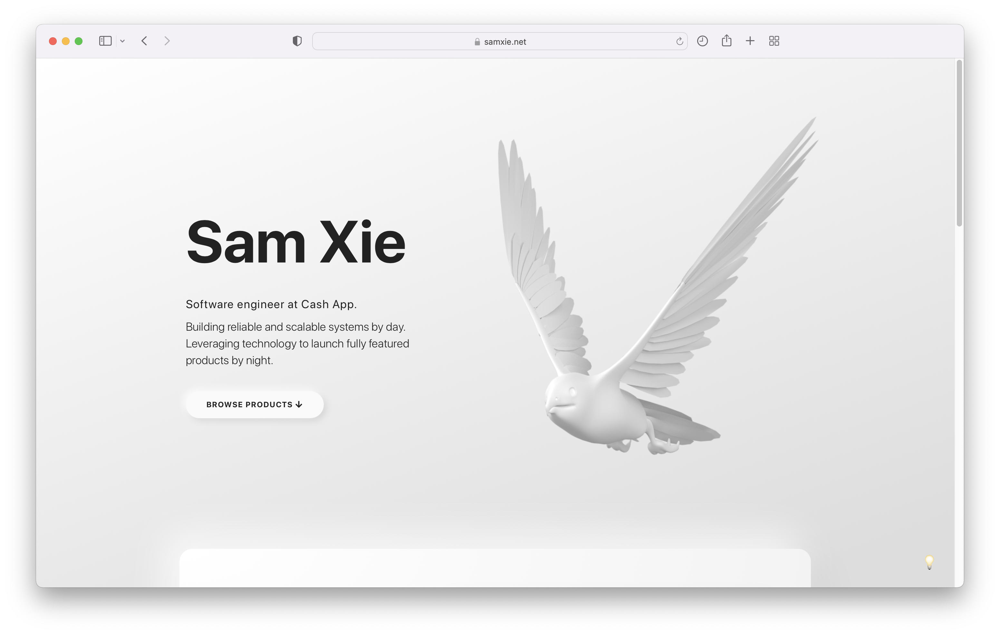

# Soft Portfolio



A neumorphic inspired personal website and portfolio.
- Showcase your project screenshots with carousels
- Link up your social and other links
- Supports light and dark mode 💡

Demo: https://samxie.net/

## Deploy your own

Clone and deploy with vercel.

[](https://vercel.com/new/git/external?repository-url=https%3A%2F%2Fgithub.com%2Fsamzx%2Fsoft-portfolio)

### Configurations
- Under `src/data/fixtures.ts`, edit to customise copy.

- Under `src/themes`, edit light and dark themes (including background image).

- Render your own 3D model by editing `blender/peregrine-falcon.blend` using [Blender](https://www.blender.org/) for free.

- Download company logos and use [Figma](https://www.figma.com/) to edit and export svg with no borders.

Push your changes to main to auto-deploy to vercel. Pull requests get preview deployments. `vercel.json` pins the Vite build (output `dist`) and rewrites non-file routes to `index.html`, so history-mode routes like `/about` load correctly when visited directly.

## Development
```
npm install
```

### Compiles and hot-reloads for development
```
npm run dev
```

### Compiles and minifies for production
```
npm run build
```

### Lints files
```
npm run lint
```

Built with Vue 3 + Vite (migrated from Vue 2 + Vue CLI — see the migration PR).
